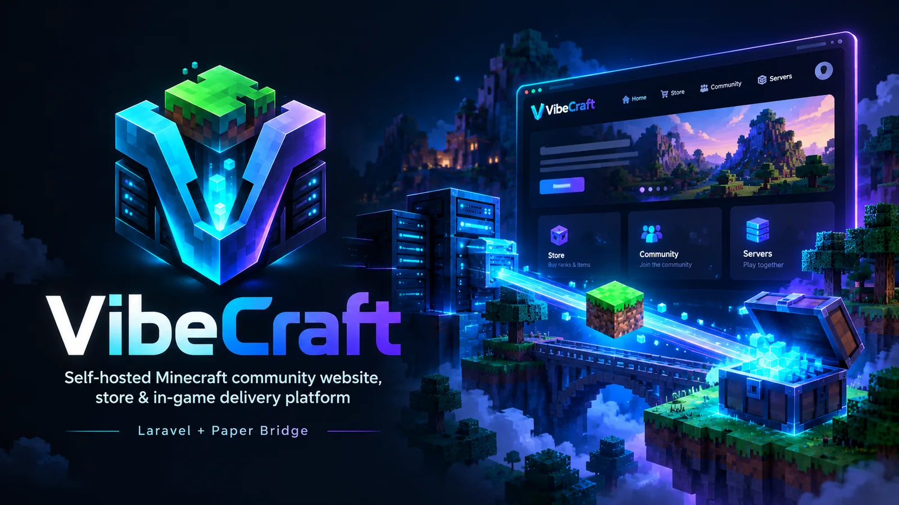
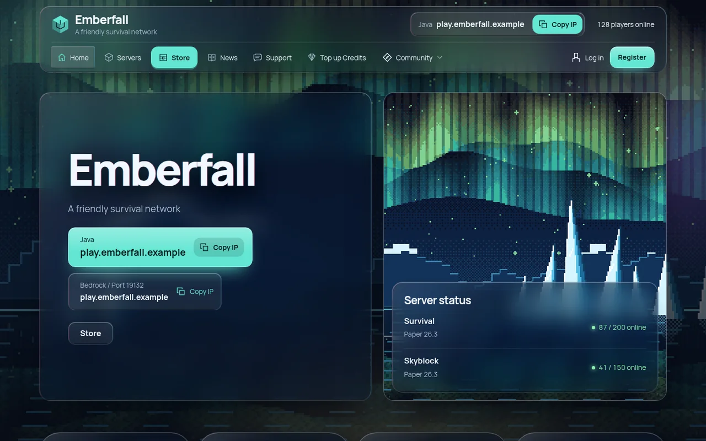
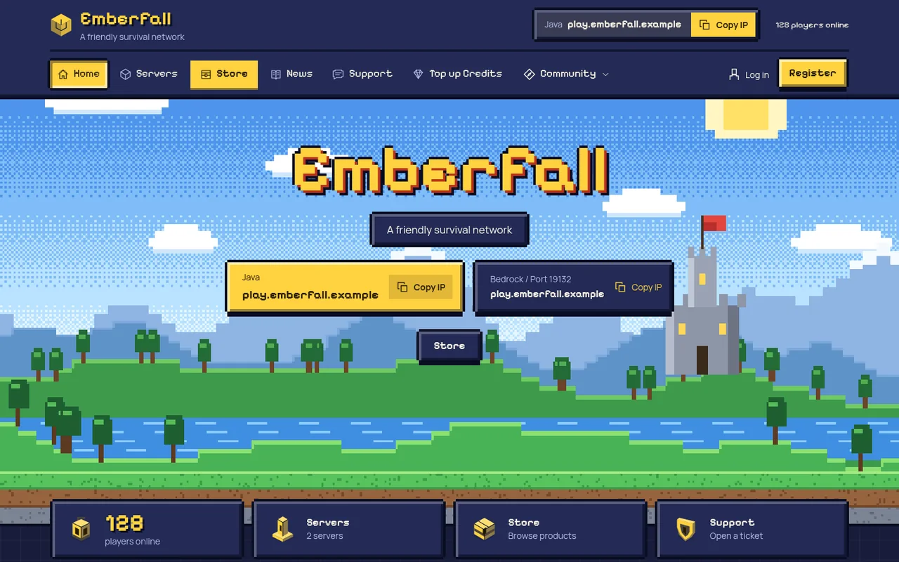
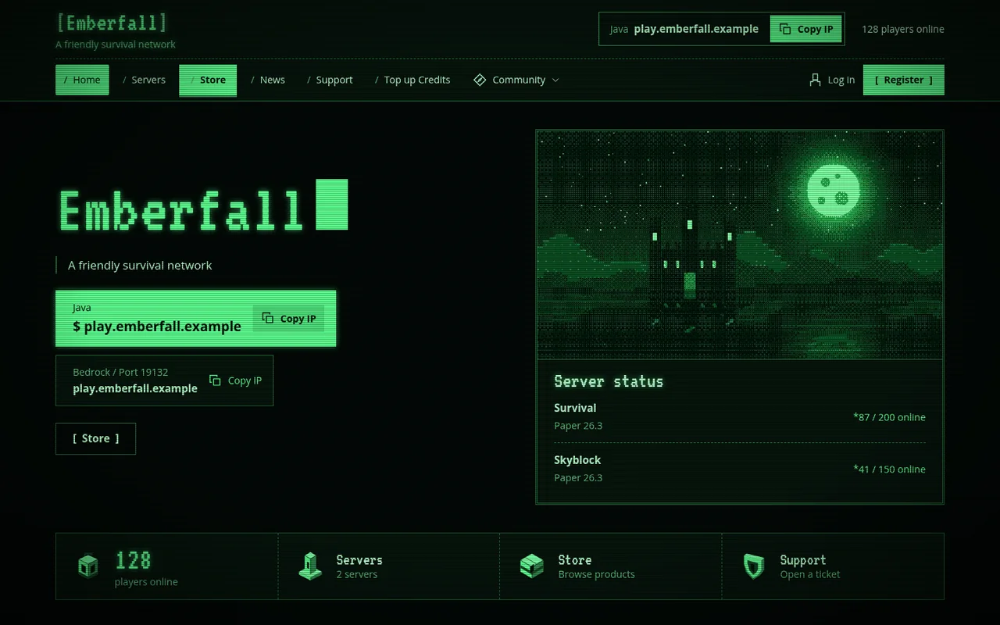
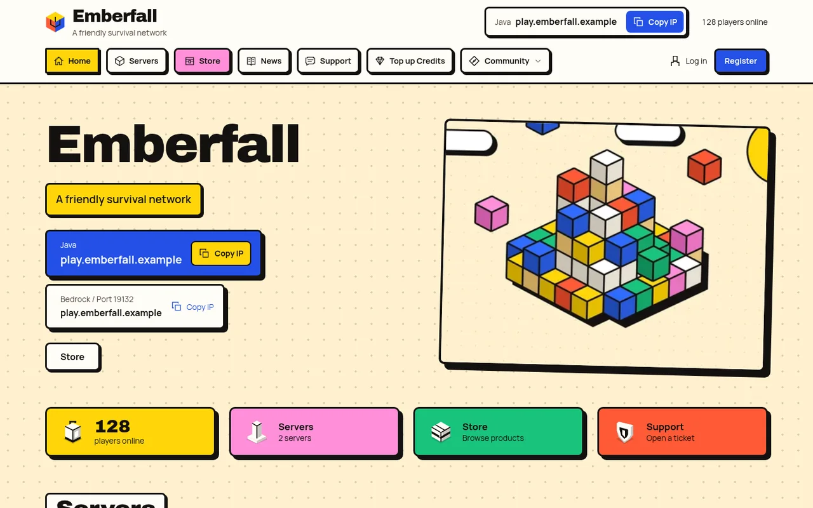
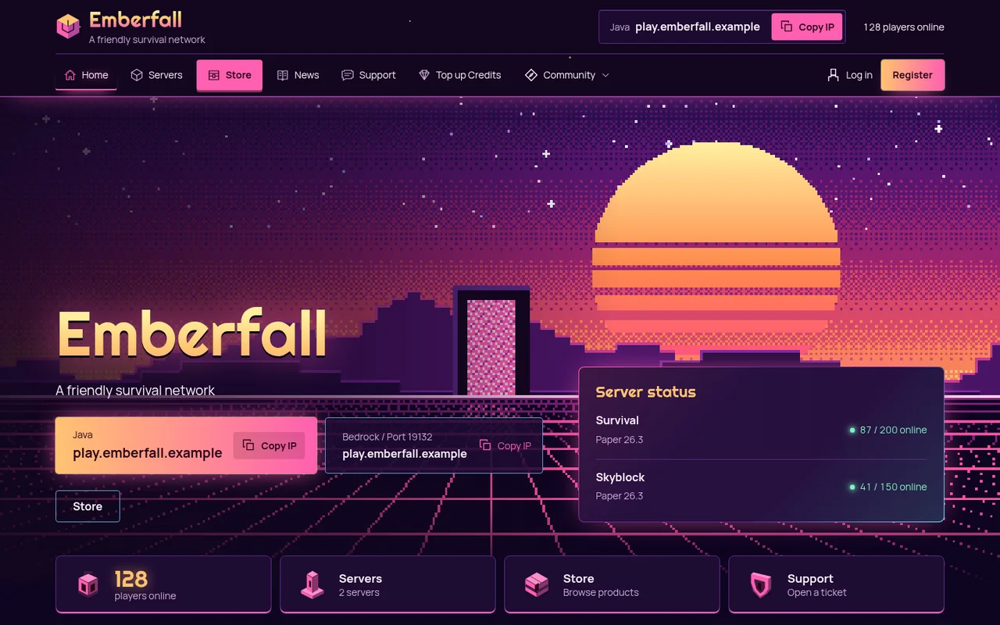

<p align="center">
  
</p>

<p align="center">
  
  
  
  
  
</p>

<p align="center">
  <a href="#türkçe">Türkçe</a> ·
  <a href="#english">English</a> ·
  <a href="docs/wiki/Home.md">Wiki</a> ·
  <a href="https://gitlab.com/siberanka/vibecraft/-/releases">İndir / Download</a>
</p>

## Türkçe

VibeCraft, Minecraft sunucuları için kendi hostinginizde çalışan topluluk sitesi, mağaza ve oyun içi
teslimat platformudur. Türkçe ve İngilizce hazır gelir.

- **Web sitesi:** PHP 8.4+, Laravel 13, Blade ve sade CSS/JavaScript. Node derlemesi, Redis veya sürekli
  çalışan bir kuyruk işçisi gerekmez. Zamanlanmış işler tek bir cron satırıyla çalışır; paylaşımlı cPanel
  hostinge uygundur.
- **Oyun eklentisi:** Paper 26.3 / Java 25 için [VibeCraft Paper Bridge](bridge/paper/README.md) (Velocity
  modern forwarding ve Floodgate desteklenir). İmzalı teslimatları siteden çeker ve kalıcı bir yerel kayıt
  tutar; aynı komut iki kez çalışmaz.


<sub>Ekran görüntülerinde örnek verili hayali bir demo sunucu ("Emberfall") ve pakette gelen görseller kullanılmıştır.</sub>

### Temalar

On hazır tema gelir; hepsi yönetim panelinden tek tıkla değişir, içerik ve siparişler yerinde kalır.

| Prism — sıvı cam | Arcade — retro piksel |
|---|---|
|  |  |
| **Terminal — komut konsolu** | **Brick — cesur bloklar** |
|  |  |
| **Dusk — neon gün batımı** | **Forge — hayatta kalma ve ekonomi** |
|  |  |
| **Volt — rekabetçi arena** | **Nomad — macera ve RPG** |
|  |  |
| **Mono — sade** | **Atlas — sunucu ağı** |
|  |  |

Tema ayrıntıları: [Wiki → Görünüm ve Temalar](docs/wiki/Gorunum-ve-Temalar.md).

### Özellikler

- On hazır tema: Atlas, Forge, Volt, Nomad, Mono ve yeni Prism (sıvı cam), Arcade (retro piksel), Terminal
  (komut konsolu), Brick (cesur bloklar), Dusk (neon gün batımı). Tema renk düzenleyici, ana sayfa bölüm
  sırası, üst/alt menü düzenleyici ve denetlenen özel CSS.
- Mağaza: kategoriler, kuponlar, kredi kodları, bonuslu kredi paketleri, başka oyuncuya hediye, hesap
  bakiyesinden otomatik yenilenen süreli rütbeler ve teslimat sandığı.
- Her hareketin bir kez işlendiği cüzdan defteri; imzalı webhook'larla Stripe ve PayTR ödemeleri.
- Doğrulanmış Minecraft (Java ve Bedrock) hesap bağlama, Discord bağlama, oyuncu profilleri ve rozetler.
- Haberler, sayfalar, sürüm geçmişli ve okuyucu erişim kurallı sunucu rehberi (wiki), forum, destek
  talepleri, yetkili başvuruları, oy siteleri, sıralamalar ve cezalar sayfası.
- Yükleme destekli görsel seçici ve pakette gelen özgün piksel sanat ikon kütüphanesi.
- Site sahibinin yönettiği hukuki belgeler ve sipariş anı kayıtları, personel rolleri ve yetkileri, TOTP iki
  aşamalı doğrulama ve denetim günlüğü.

### cPanel'e kurulum

1. [Son sürümden](https://gitlab.com/siberanka/vibecraft/-/releases) `vibecraft-<sürüm>.zip` dosyasını indirin
   ve `SHA256SUMS` ile doğrulayın.
2. Alan adı için PHP 8.4+ seçin, boş bir MySQL/MariaDB veritabanı ve kullanıcı oluşturun.
3. Zip'i yükleyip açın; alan adının kök klasörünü `public/` klasörüne yönlendirin (ya da içeriği doğrudan
   `public_html` içine koyun; pakette gelen `.htaccess` `public/` dışındaki her şeyi erişilemez tutar).
4. Sitenizi açın: tarayıcıdaki kurulum sihirbazı `storage/app/setup-token.txt` dosyasındaki kurulum kodunu,
   veritabanı bilgilerini ve sahip hesabını ister. Terminal gerekmez.
5. Sihirbazın gösterdiği cron satırını ekleyin.

Ekran ekran anlatım: [Wiki → Kurulum](docs/wiki/Kurulum.md).

### Paper eklentisi

Her sürümle hazır `VibeCraftBridge-<sürüm>.jar` gelir. Sunucunun `plugins/` klasörüne koyun ve
[Wiki → Paper Eklentisi](docs/wiki/Paper-Eklentisi.md) adımlarını izleyin. Kaynaktan derlemek için
[Wiki → Geliştirme](docs/wiki/Gelistirme.md) sayfasına bakın.

### Belgeler

| | |
|---|---|
| [Wiki (Türkçe)](docs/wiki/Home.md#türkçe) | Kurulum, mağaza, ödemeler, eklenti, temalar, güvenlik, bakım ve sorun giderme |
| [Kurulum ve işletim](docs/INSTALL.md) | Ayrıntılı kurulum, cron, güncelleme ve kurtarma (İngilizce) |
| [Güvenlik](docs/SECURITY.md) | Dağıtım sınırları, Cloudflare profili ve yedekler (İngilizce) |
| [Kabul kontrol listesi](docs/RELEASE_CHECKLIST.md) | Gerçek ödeme almadan önce hostingde yapılacak kontroller |

### Güvenlik

Güvenlik açıklarını herkese açık issue yerine [SECURITY.md](SECURITY.md) dosyasında anlatıldığı gibi gizli
olarak bildirin.

### Lisans

VibeCraft'ı ve eklentisini kendi sunucularınız ve topluluğunuz için (kendi mağazasıyla gelir elde eden
sunucular dahil) kurabilir, değiştirebilir ve kullanabilirsiniz. VibeCraft'ı, eklentiyi, bir fork'u veya
adı değiştirilmiş bir kopyasını satmak, kiralamak, yeniden satmak ya da ücretli ürün veya barındırma hizmeti
olarak sunmak yasaktır. Kopyalanan kod VibeCraft'a atıf vermelidir. Ayrıntılar [LICENSE](LICENSE) ve
[NOTICE](NOTICE) dosyalarındadır.

VibeCraft resmi bir Minecraft ürünü değildir; Mojang veya Microsoft tarafından onaylanmamıştır ve onlarla
bağlantılı değildir.

---

## English

A self-hosted community website, store and in-game delivery platform for Minecraft servers.
Turkish and English out of the box.

- **Website:** PHP 8.4+, Laravel 13, Blade and plain CSS/JavaScript. No Node build step, no Redis and no
  long-running queue worker are required. Scheduled work runs from a single cron line, so it fits shared
  cPanel hosting.
- **Game plugin:** the [VibeCraft Paper Bridge](bridge/paper/README.md) for Paper 26.3 / Java 25 (Velocity
  modern forwarding and Floodgate supported). It pulls signed deliveries from the website and keeps a
  durable local journal so a command is never run twice.

### Screenshots

#### Themes

| Forge | Volt |
|---|---|
|  |  |
| **Nomad** | **Mono** |
|  |  |
| **Prism — liquid glass** | **Arcade — retro pixel** |
|  |  |
| **Terminal — command console** | **Brick — bold blocks** |
|  |  |
| **Dusk — neon sunset** | **Atlas — network** |
|  |  |

Theme details: [Wiki → Appearance and Themes](docs/wiki/Appearance-and-Themes.md).

#### Store and servers

| Store | Product |
|---|---|
|  |  |
| **Servers** | **Credit packages** |
|  |  |

#### Administration and mobile

| Image picker with the bundled icon library | Mobile |
|---|---|
|  |  |

### Features

- Ten built-in themes: Atlas, Forge, Volt, Nomad, Mono and the new Prism (liquid glass), Arcade (retro
  pixel), Terminal (command console), Brick (bold blocks) and Dusk (neon sunset), with a theme editor,
  home-section ordering, header/footer menu editor and checked custom CSS.
- Store with categories, coupons, gift codes, credit packages with bonus credit, gifts to other players,
  timed ranks with automatic renewal from the account balance and a delivery chest.
- Wallet ledger with idempotent postings; Stripe and PayTR payments with signed webhooks.
- Verified Minecraft (Java and Bedrock) account linking, Discord linking, player profiles and badges.
- News, pages, a server guide / wiki with revision history and reader access rules, forum, tickets,
  staff applications, vote sites, leaderboards and a punishments page.
- Image picker with uploads and a bundled library of original pixel-art icons.
- Owner-managed legal documents with order-time evidence, staff roles and permissions, TOTP two-factor
  authentication and an audit log.

### Requirements

- PHP 8.4 or newer with the extensions listed in [docs/INSTALL.md](docs/INSTALL.md) (including PDO MySQL, GD, intl, mbstring and OpenSSL)
- MySQL 8 or MariaDB with InnoDB (SQLite is used for tests)
- HTTPS for production
- For the plugin: Paper 26.3 with Java 25

### Install on shared hosting (cPanel)

1. Download `vibecraft-<version>.zip` from the [latest release](https://gitlab.com/siberanka/vibecraft/-/releases)
   and verify it with `SHA256SUMS`.
2. Select PHP 8.4+ for the domain, create an empty MySQL/MariaDB database and user.
3. Upload and extract the zip, point the domain to its `public/` folder (or put the contents in
   `public_html`; the bundled `.htaccess` keeps everything except `public/` unreachable).
4. Open your site: the browser installer asks for the setup token from
   `storage/app/setup-token.txt`, the database details and the owner account. No terminal needed.
5. Add the cron line shown by the installer.

Step-by-step guide with the cPanel menu names: [Wiki → Installation](docs/wiki/Installation.md).

### Quick start (local development)

```sh
composer install
cp .env.example .env
php artisan key:generate
php artisan migrate
php artisan vibecraft:setup-token
php artisan serve --host=127.0.0.1
```

Set `APP_ENV=local`, `APP_URL=http://localhost:8000` and `SESSION_SECURE_COOKIE=false` for local use and
point the database settings at a local MySQL/MariaDB. Open `/install` and use the setup token to create the
owner account. There is no default user or password. Composer 2 is needed for a source checkout.

### The Paper plugin

Each release ships a ready `VibeCraftBridge-<version>.jar`: drop it into the server's `plugins/` folder and
follow [Wiki → Paper Plugin](docs/wiki/Paper-Plugin.md). To build it yourself without Gradle, Maven or
downloads, put the six pinned API jars listed in `bridge/paper/dependencies.sha256` in a directory, then:

```sh
cd bridge/paper
sh build.sh /absolute/path/to/provided-api-jars
```

The jar is written to `bridge/paper/target/`. The wire protocol is in [docs/BRIDGE.md](docs/BRIDGE.md).

### Tests

```sh
php artisan test
php -d opcache.enable_cli=0 vendor/bin/phpstan analyse --memory-limit=256M --no-progress
```

### Documentation

| | |
|---|---|
| [Wiki (English)](docs/wiki/Home.md#english) | Installation, store, payments, plugin, themes, security, maintenance and troubleshooting |
| [Installation and operations](docs/INSTALL.md) | Detailed install, cron, updates and recovery |
| [Security](docs/SECURITY.md) | Deployment boundaries, Cloudflare profile and backups |
| [Release checklist](docs/RELEASE_CHECKLIST.md) | Checks on the real host before taking real payments |

### Security

Deployment hardening is described in [docs/SECURITY.md](docs/SECURITY.md). Please report vulnerabilities
privately as described in [SECURITY.md](SECURITY.md), not in public issues.

### License

VibeCraft is licensed under the [VibeCraft License](LICENSE): the PolyForm Noncommercial License 1.0.0 with
additional terms. You may build, change and run VibeCraft and its plugin for your own servers and community,
including servers that earn money through their own store. You may not sell, rent or resell VibeCraft, the
plugin, a fork or a renamed copy, or offer it as a paid product or hosted service. Copied code must credit
VibeCraft. See [NOTICE](NOTICE) for a summary and third-party licenses.

VibeCraft is not an official Minecraft product and is not approved by or associated with Mojang or
Microsoft.
