# VibeCraft

A self-hosted community website, store and in-game delivery platform for Minecraft servers.
Turkish and English out of the box.

- **Website:** PHP 8.4+, Laravel 13, Blade and plain CSS/JavaScript. No Node build step, no Redis and no
  long-running queue worker are required. Scheduled work runs from a single cron line, so it fits shared
  cPanel hosting.
- **Game plugin:** the [VibeCraft Paper Bridge](bridge/paper/README.md) for Paper 26.3 / Java 25 (Velocity
  modern forwarding and Floodgate supported). It pulls signed deliveries from the website and keeps a
  durable local journal so a command is never run twice.

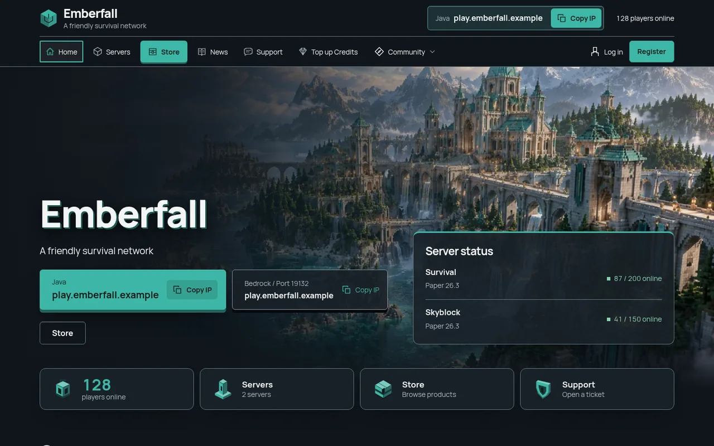

<sub>Screenshots use a fictional demo server ("Emberfall") with sample data and the bundled artwork.</sub>

## Screenshots

### Themes

| Forge | Volt |
|---|---|
| 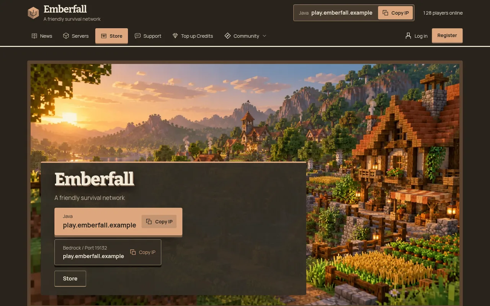 | 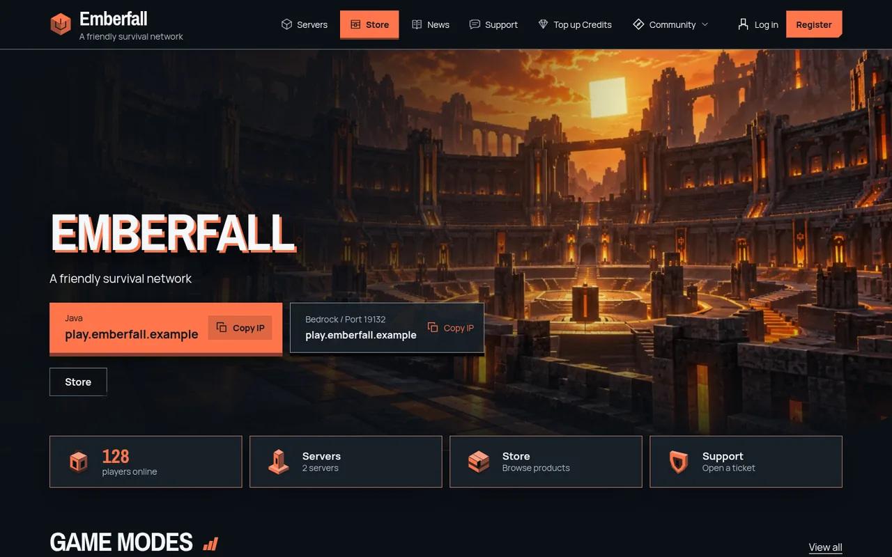 |
| **Nomad** | **Mono** |
| 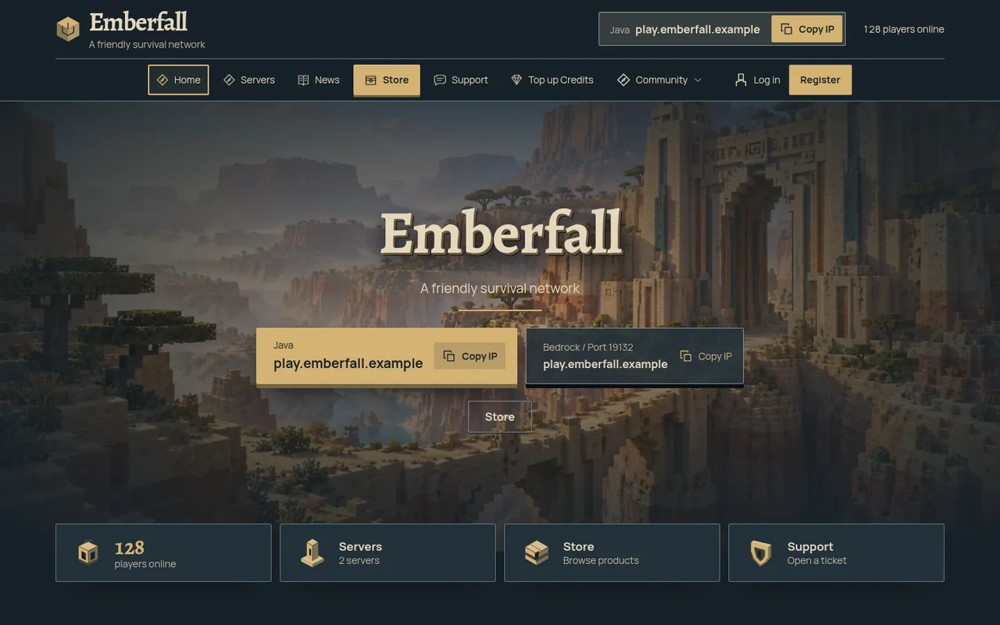 | 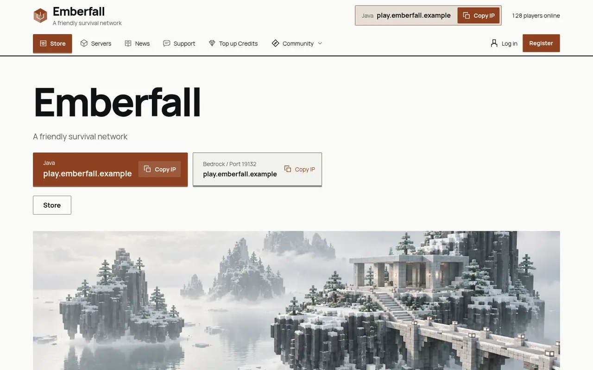 |

### Store and servers

| Store | Product |
|---|---|
| 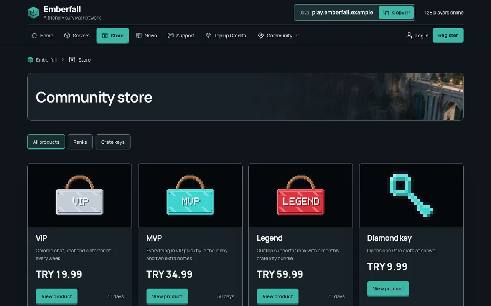 | 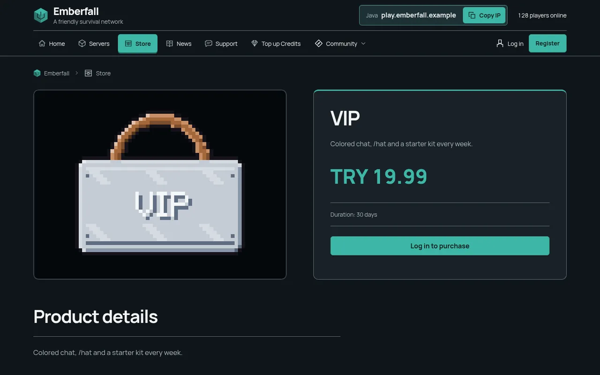 |
| **Servers** | **Credit packages** |
| 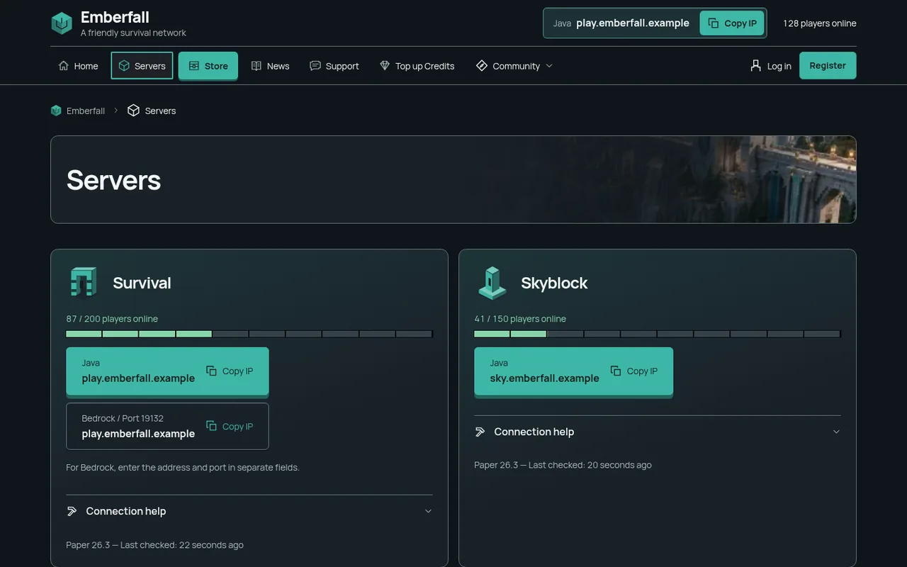 | 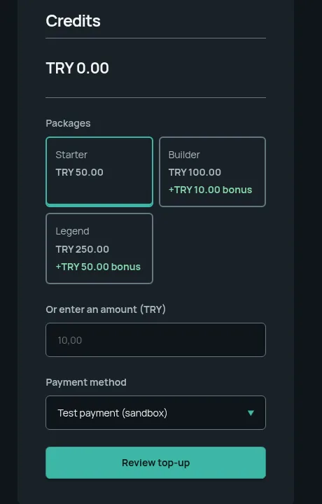 |

### Administration and mobile

| Image picker with the bundled icon library | Mobile |
|---|---|
| 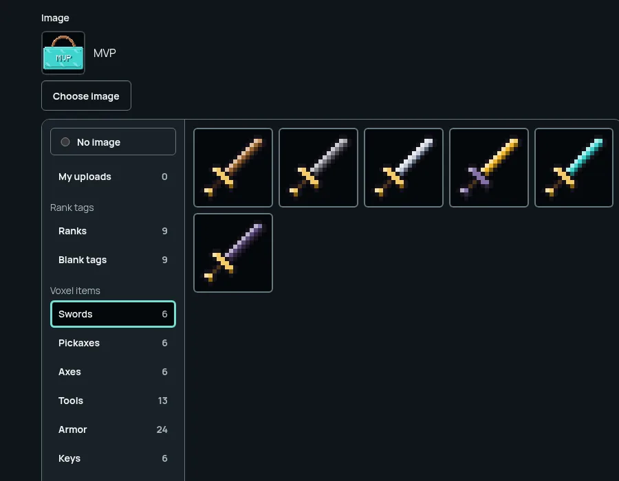 | 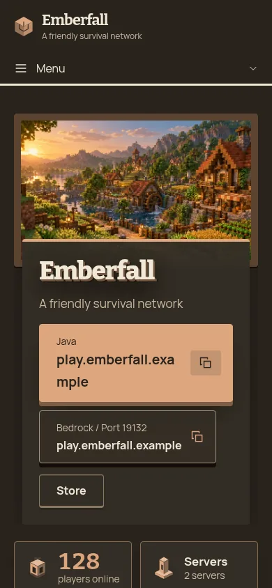 |

## Features

- Five built-in themes (Atlas, Forge, Volt, Nomad, Mono) with a theme editor, home-section ordering,
  header/footer menu editor and checked custom CSS.
- Store with categories, coupons, gift codes, credit packages with bonus credit, gifts to other players,
  timed ranks with automatic renewal from the account balance and a delivery chest.
- Wallet ledger with idempotent postings; Stripe and PayTR payments with signed webhooks.
- Verified Minecraft (Java and Bedrock) account linking, Discord linking, player profiles and badges.
- News, pages, a server guide / wiki with revision history and reader access rules, forum, tickets,
  staff applications, vote sites, leaderboards and a punishments page.
- Image picker with uploads and a bundled library of original pixel-art icons.
- Owner-managed legal documents with order-time evidence, staff roles and permissions, TOTP two-factor
  authentication and an audit log.

## Requirements

- PHP 8.4 or newer with the extensions listed in [docs/INSTALL.md](docs/INSTALL.md) (including PDO MySQL, GD, intl, mbstring and OpenSSL)
- MySQL 8 or MariaDB with InnoDB (SQLite is used for tests)
- Composer 2
- HTTPS for production
- For the plugin: JDK 25 and Paper 26.3

## Install on shared hosting (cPanel)

1. Download `vibecraft-<version>.zip` from the latest release and verify it with `SHA256SUMS`.
2. Select PHP 8.4+ for the domain, create an empty MySQL/MariaDB database and user.
3. Upload and extract the zip, point the domain to its `public/` folder (or put the contents in
   `public_html`; the bundled `.htaccess` keeps everything except `public/` unreachable).
4. Open your site: the browser installer asks for the setup token from
   `storage/app/setup-token.txt`, the database details and the owner account. No terminal needed.
5. Add the cron line shown by the installer.

Step-by-step guide with the cPanel menu names: [docs/INSTALL.md](docs/INSTALL.md).

## Quick start (local development)

```sh
composer install
cp .env.example .env
php artisan key:generate
php artisan migrate
php artisan vibecraft:setup-token
php artisan serve --host=127.0.0.1
```

Set `APP_ENV=local`, `APP_URL=http://localhost:8000` and `SESSION_SECURE_COOKIE=false` for local use and
point the database settings at a local MySQL/MariaDB. Open `/install` and use the setup token to create the
owner account. There is no default user or password.

For production hosting follow [docs/INSTALL.md](docs/INSTALL.md) and the
[release checklist](docs/RELEASE_CHECKLIST.md).

## Building the Paper plugin

Each release also ships a ready `VibeCraftBridge-<version>.jar`: drop it into the server's `plugins/` folder and
follow [bridge/paper/README.md](bridge/paper/README.md). To build it yourself without Gradle, Maven or downloads, put the six pinned API jars listed in
`bridge/paper/dependencies.sha256` in a directory, then:

```sh
cd bridge/paper
sh build.sh /absolute/path/to/provided-api-jars
```

The jar is written to `bridge/paper/target/`. Server setup, command approval and recovery are described in
[bridge/paper/README.md](bridge/paper/README.md); the wire protocol is in [docs/BRIDGE.md](docs/BRIDGE.md).

## Tests

```sh
php artisan test
php -d opcache.enable_cli=0 vendor/bin/phpstan analyse --memory-limit=256M --no-progress
```

## Security

Deployment hardening is described in [docs/SECURITY.md](docs/SECURITY.md). Please report vulnerabilities
privately as described in [SECURITY.md](SECURITY.md), not in public issues.

## License

VibeCraft is licensed under the [VibeCraft License](LICENSE): the PolyForm Noncommercial License 1.0.0 with
additional terms. You may build, change and run VibeCraft and its plugin for your own servers and community,
including servers that earn money through their own store. You may not sell, rent or resell VibeCraft, the
plugin, a fork or a renamed copy, or offer it as a paid product or hosted service. Copied code must credit
VibeCraft. See [NOTICE](NOTICE) for a summary and third-party licenses.

VibeCraft is not an official Minecraft product and is not approved by or associated with Mojang or
Microsoft.

---

## Türkçe

VibeCraft; Minecraft sunucuları için kendi sunucunuzda barındırdığınız topluluk sitesi, mağaza ve oyun içi
teslimat platformudur. Web uygulaması PHP 8.4+ ve Laravel 13 ile çalışır, cPanel paylaşımlı hostinge
uygundur; Paper eklentisi imzalı teslimatları siteden çeker.

Kurulum için [docs/INSTALL.md](docs/INSTALL.md), eklenti derlemesi için
[bridge/paper/README.md](bridge/paper/README.md) dosyasını okuyun.

Lisans: VibeCraft'ı ve eklentisini kendi sunucularınız için (gelir elde edenler dahil) kurup
değiştirebilir ve kullanabilirsiniz. Adını değiştirerek veya değiştirmeden satmak, kiralamak, ücretli paket
ya da barındırma hizmeti olarak sunmak yasaktır; kopyalanan kod VibeCraft'a atıf vermelidir. Ayrıntılar
[LICENSE](LICENSE) ve [NOTICE](NOTICE) dosyalarındadır.
