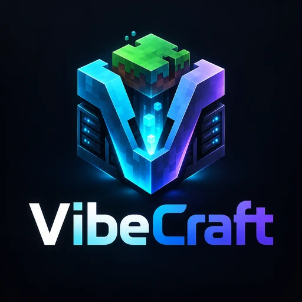

  

# VibeCraft Wiki

VibeCraft is a self-hosted community website, store and in-game delivery platform for Minecraft servers.
This wiki explains how to install it, set it up and run it day to day.

VibeCraft; Minecraft sunucuları için kendi hostinginizde çalışan topluluk sitesi, mağaza ve oyun içi
teslimat platformudur. Bu wiki kurulumu, ayarları ve günlük işletimi anlatır.

## Türkçe

| Sayfa | İçerik |
|---|---|
| [Kurulum](Kurulum.md) | cPanel'e adım adım kurulum, iki klasör yerleşimi, cron |
| [İlk Adımlar](Ilk-Adimlar.md) | Kurulumdan sonra yapılacaklar: iki aşamalı doğrulama, e-posta, site bilgileri |
| [Mağaza](Magaza.md) | Kategoriler, ürünler, komutlar, süreli rütbeler, kuponlar, kredi paketleri ve kodları |
| [Ödemeler](Odemeler.md) | Stripe, PayTR, webhook adresleri, cüzdan ve iadeler |
| [Paper Eklentisi](Paper-Eklentisi.md) | Eklentiyi kurma, anahtarlar, izinli komutlar, hesap bağlama, teslimat kaydı |
| [Görünüm ve Temalar](Gorunum-ve-Temalar.md) | On tema, renkler, bölüm sırası, menüler, özel CSS, görsel kütüphanesi |
| [Topluluk Özellikleri](Topluluk-Ozellikleri.md) | Haberler, sayfalar, wiki, forum, destek, başvurular, oylar, sıralama, cezalar, Discord |
| [Roller ve Yetkiler](Roller-ve-Yetkiler.md) | Hazır roller, yetki listesi, personel güvenliği |
| [Güvenlik](Guvenlik.md) | Korunan dosyalar, CAPTCHA, Cloudflare, yedekler, açık bildirme |
| [Güncelleme ve Bakım](Guncelleme-ve-Bakim.md) | Sürüm güncelleme, zamanlanmış işler, konsol komutları |
| [Sorun Giderme](Sorun-Giderme.md) | Sık karşılaşılan sorunlar ve çözümleri |
| [Geliştirme](Gelistirme.md) | Kaynaktan çalıştırma, testler, eklentiyi derleme, sürüm paketi |

## English

| Page | Contents |
|---|---|
| [Installation](Installation.md) | Step-by-step cPanel install, both folder layouts, cron |
| [First Steps](First-Steps.md) | After installing: two-factor authentication, mail, site details |
| [Store](Store.md) | Categories, products, commands, timed ranks, coupons, credit packages and codes |
| [Payments](Payments.md) | Stripe, PayTR, webhook addresses, wallet and refunds |
| [Paper Plugin](Paper-Plugin.md) | Installing the plugin, keys, allowed commands, account linking, delivery journal |
| [Appearance and Themes](Appearance-and-Themes.md) | Ten themes, colours, section order, menus, custom CSS, image library |
| [Community Features](Community-Features.md) | News, pages, wiki, forum, support, applications, votes, leaderboards, punishments, Discord |
| [Roles and Permissions](Roles-and-Permissions.md) | Built-in roles, permission list, staff security |
| [Security](Security.md) | Protected files, CAPTCHA, Cloudflare, backups, reporting issues |
| [Updates and Maintenance](Updates-and-Maintenance.md) | Updating, scheduled tasks, console commands |
| [Troubleshooting](Troubleshooting.md) | Common problems and fixes |
| [Development](Development.md) | Running from source, tests, building the plugin, release package |

## Quick facts

- **Website:** PHP 8.4+, Laravel 13, MySQL 8 or MariaDB. No Node, Redis or queue worker needed; one cron line.
- **Plugin:** Paper 26.3 on Java 25; Velocity modern forwarding and Floodgate (Bedrock) supported.
- **Languages:** Turkish and English for the site, the admin panel and e-mails.
- **License:** [VibeCraft License](../../LICENSE): free to run on your own servers, including ones that earn
  money; selling or renaming it is not allowed.
